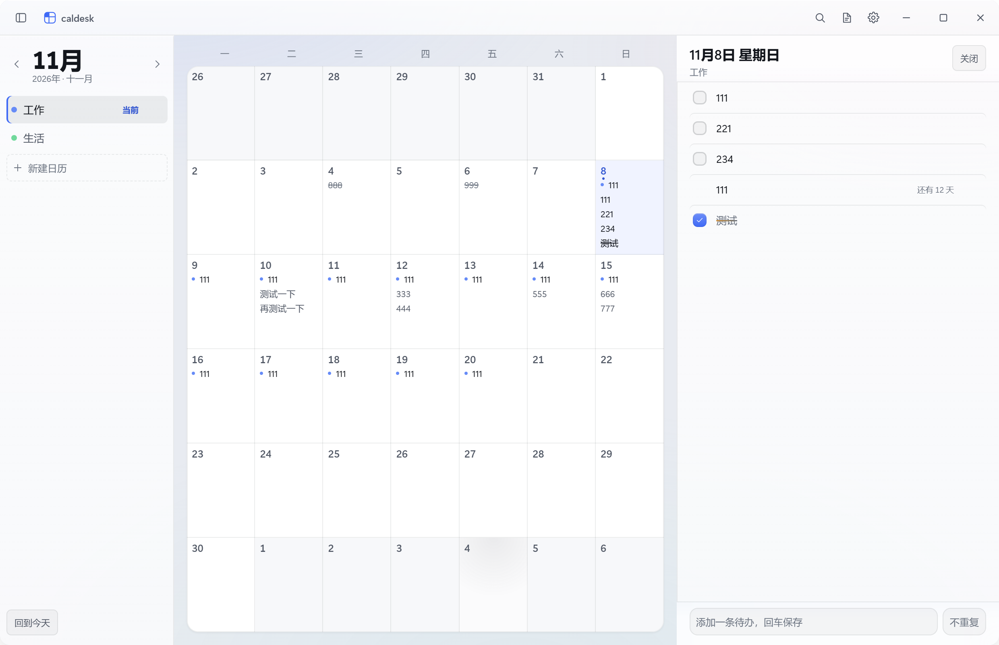
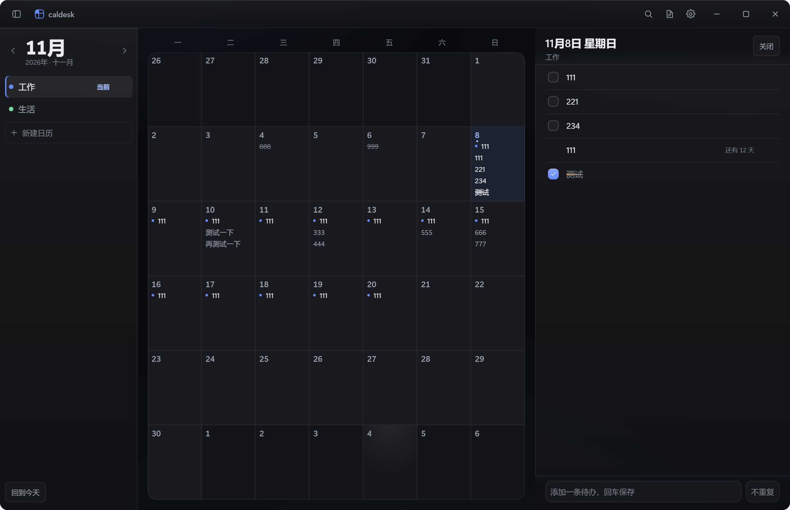
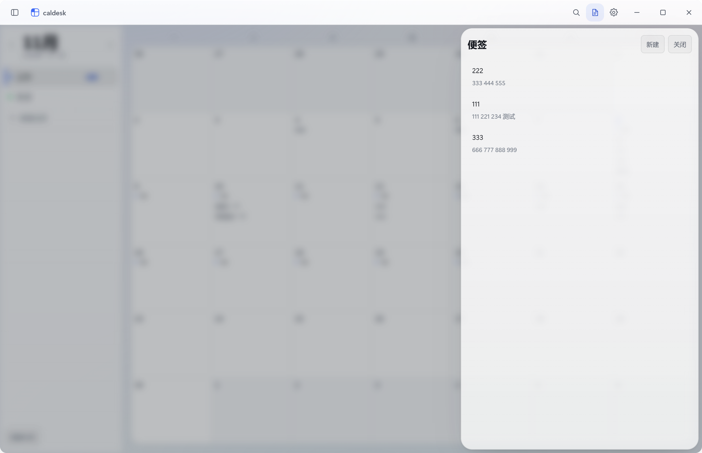
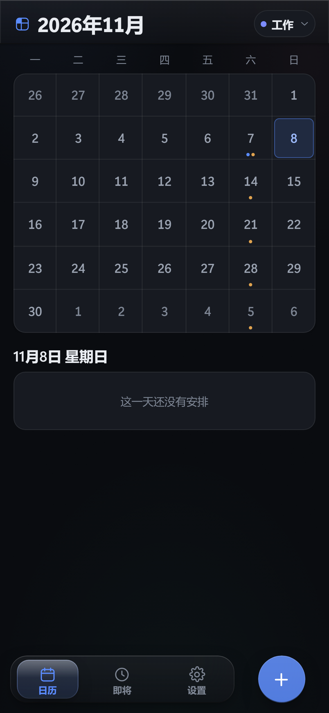

<h1 align="center">caldesk</h1>

<p align="center">桌面待办与日历 — 内置 MCP，AI 可直接读写日程；手机与电脑通过 Cloudflare Worker 同步。</p>

<p align="center">
  <a href="https://github.com/Mortonnn/caldesk/releases">
    
  </a>
  <a href="https://github.com/Mortonnn/caldesk">
    
  </a>
  
  
  
  
  
</p>

## 特性

- **内置 MCP 服务**：启动后在 `127.0.0.1:19283` 提供 JSON-RPC 2.0 端点，开放 20 个工具，Claude Desktop、Cursor、Codex 等客户端可直接读写日程
- **手机与电脑同步**：配套 Cloudflare Worker + D1 后端，SQL 增量同步，双向 LWW 合并，可管理已登录设备
- **月历与每日待办**：按天记录多行待办，回车连续录入，勾选完成，行可跨天移动
- **重复日程与倒数日**：RFC 5545 RRULE（FREQ / INTERVAL / COUNT / UNTIL / BYDAY / BYMONTHDAY），支持跳过单次或整体修改
- **便签与全文搜索**：独立便签面板，支持置顶；跨待办、事件、便签检索并定位到具体行
- **桌面浮窗与托盘**：常驻右下角微缩窗口；托盘图标按 DPI 分档原生绘制
- **本地存储**：数据存于本地 SQLite（`node:sqlite`），无原生模块编译依赖
- **历史回滚**：保留最近 100 次修改快照

## 界面预览

<p align="center">桌面端月历 · 浅色</p>

<p align="center"></p>

<p align="center">桌面端月历 · 深色</p>

<p align="center"></p>

<p align="center">便签面板</p>

<p align="center"></p>

<p align="center">移动端 · 浅色与深色</p>

<p align="center">
  
  &nbsp;&nbsp;
  
</p>

## 下载安装

安装包见 [Releases](../../releases)。

| 平台 | 文件 | 说明 |
| --- | --- | --- |
| Windows 10/11 x64 | `caldesk-1.0.0-setup.exe` | 默认安装到 `C:\Program Files\caldesk` |
| Android 8.0+ | `caldesk-1.0.0.apk` | |

首次安装后在设置里填写同步服务器地址即可；纯离线使用可留空。

## AI 接入

桌面端启动后在本地回环地址开放 MCP 服务，仅监听本机。打开「设置 → AI 配置指南」，可将当前版本的工具说明一键复制给 AI 客户端。

以 Claude Desktop 为例，编辑 `%APPDATA%\Claude\claude_desktop_config.json`：

```json
{
  "mcpServers": {
    "caldesk": {
      "command": "node",
      "args": ["C:/Program Files/caldesk/resources/bin/cal-mcp.mjs"]
    }
  }
}
```

安装包与源码两种情形路径不同：源码为 `<仓库目录>/bin/cal-mcp.mjs`；均需本机 Node.js 18+。

工具分为三组：`items_*`（日格待办）、`events_*`（重复任务 / 提醒 / 倒数日）、`notes_*`（便签），另有 `search` 与 `context`。完整参数见 [docs/AI控制日历-速查.md](docs/AI控制日历-速查.md)。

命令行工具：

```bash
node bin/cal.mjs list                      # 查看本月安排
node bin/cal.mjs add 2026-11-07 "复诊"      # 为指定日期添加待办
node bin/cal.mjs day 2026-11-07            # 查看指定日期
node bin/cal.mjs done 2026-11-07 0         # 标记完成
node bin/cal.mjs search "作业"              # 全文检索
```

## 同步后端

同步后端为 Cloudflare Worker + D1，需自行部署：

```bash
cd worker
npm install
npx wrangler d1 create caldesk          # 将输出的 database_id 填入 wrangler.toml
npx wrangler d1 execute caldesk --file=./schema.sql
npx wrangler deploy
```

两端在「设置 → 同步」中填入同一 Worker 地址，注册同一账号即可。官方安装包预填了一个公共同步服务器，可直接使用；该实例按免费额度运行，可能限流，长期使用建议自建。

## 数据与隐私

- 桌面端数据位于 `%APPDATA%\caldesk\caldesk.db`，单个 SQLite 文件，直接复制即为完整备份
- 移动端在 WebView 本地存储中缓存部分数据，用于离线查看
- 同步后端保存明文，**没有端到端加密**：自建时数据仅自己可见，使用公共实例时管理员可读取全部日程
- MCP 服务仅绑定 `127.0.0.1`。默认不校验令牌；如需限制同机其他程序，启动前设置 `CALDESK_MCP_TOKEN`，此后 HTTP 请求需带 `Authorization: Bearer`

## 开发

环境要求：Node.js 20+（依赖 `node:sqlite`）。

```bash
npm install
npm run dev            # 桌面端开发模式
npm run typecheck      # 类型检查
npm test               # 验收脚本，19 个用例
```

## 构建

```bash
npm run dist           # Windows 安装包 → release/
npm run build:mobile   # 移动端 Web 资源 → out/mobile/
npm run apk            # 移动端资源 + 同步 android/ + 构建 debug APK
```

构建期可注入默认服务器地址，源码中不写入任何人的服务器：

```bash
CALDESK_DEFAULT_SERVER=https://your-worker.example.com npm run dist
```

不注入时安装后需自行填写地址；纯离线使用可留空。

## 项目结构

```
├── bin/            # CLI 与 MCP stdio 桥
├── build/          # 图标资源
├── docs/           # 接口速查、部署说明、截图
├── mobile-native/  # Android 原生改动
├── scripts/        # 验收脚本（verify-* / ui-* / mobile-*）
├── src/
│   ├── main/       # 主进程：窗口、托盘、SQLite、同步、本地 MCP 服务
│   ├── preload/    # IPC 白名单桥
│   ├── renderer/   # React 界面（桌面 / 浮窗 / 移动端）
│   └── shared/     # 三端共用：类型、RRULE、工具定义
└── worker/         # Cloudflare Worker + D1 后端
```

## 许可证

[MIT](LICENSE)
